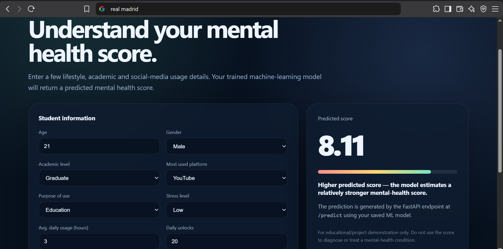

# 🧠 Mental Health Predictor

A machine learning web application that predicts a **mental health score** based on lifestyle, academic, social-media usage, and personal factors.

The project combines a trained Machine Learning model with a **FastAPI backend** and a responsive **HTML/CSS/JavaScript frontend**.

## 📌 Project Overview

Mental health can be influenced by several lifestyle and behavioral factors such as:

- Daily social media usage
- Number of phone unlocks
- Study hours
- Physical activity
- Sleep duration
- Stress level
- Academic level
- Social media platform usage
- Purpose of social media usage
- Age and gender

This project uses these factors as inputs to a trained machine learning model and returns a **predicted mental health score**.

The goal of this project is to demonstrate how a machine learning model can be converted into a usable web application and deployed as an API.

---

## ✨ Features

- 🧠 Machine Learning based prediction
- ⚡ FastAPI REST API
- 🌐 Interactive web interface
- 📊 Predicted mental health score
- ✅ Input validation using Pydantic
- 📱 Responsive frontend
- 🔄 Real-time prediction through JavaScript `fetch()`
- 📚 Automatic API documentation with Swagger UI
- ☁️ Cloud deployment using Render

---

## 🏗️ Project Architecture

```text
User
  │
  ▼
HTML / CSS / JavaScript
  │
  │ POST /predict
  ▼
FastAPI Backend
  │
  ▼
Pydantic Validation
  │
  ▼
Pandas DataFrame
  │
  ▼
Trained ML Model
  │
  ▼
Mental Health Score
  │
  ▼
JSON Response
  │
  ▼
Frontend Result

```
## 📂 Project Structure
```text
Mental-Health-Predictor/
│
├── main.py
├── requirements.txt
├── Mental_Health_Prediction.pkl
│
└── static/
    ├── index.html
    │
    ├── css/
    │   └── style.css
    │
    └── js/
        └── script.js
```
The trained .pkl model may be stored using Git LFS or another appropriate large-file solution because GitHub's standard repository file limit is 100 MB.

🧰 Tech Stack
Backend
- Python
- FastAPI
- Pydantic
- Pandas
- Uvicorn
Machine Learning
- Scikit-learn
- Joblib
- NumPy
Frontend
- HTML5
- CSS3
- JavaScript
Deployment
- GitHub

## 📥 Input Features

The API accepts the following features:

Feature	Type	Description

Age	Integer	Age of the user

Gender	Categorical	Male / Female

Academic_Level	Categorical	Undergraduate / Graduate / High School

Most_Used_Platform	Categorical	Most frequently used social media platform

Purpose_Of_Use	Categorical	Main purpose of social media usage

Avg_Daily_Usage_Hours	Float	Average daily social media usage

Daily_Unlocks	Integer	Number of device unlocks per day

Study_Hours	Float	Daily study hours

Physical_Activity_Hours	Float	Daily physical activity

Sleep_Hours_Per_Night	Float	Average nightly sleep

Stress_Level	Categorical	Low / Medium / High / Very High

## 🖥️ Live Application Preview



## 🔮 Prediction

The model returns a predicted mental health score as a numerical value.

Example API response:
{
    "predicted": 5.81
}

The frontend converts this prediction into a user-friendly result.
## 🔌 API

POST /predict

Accepts user information and returns the predicted mental health score.

Example Request
```
{
    "Age": 21,
    "Gender": "Male",
    "Academic_Level": "Undergraduate",
    "most_used_platform": "Instagram",
    "purpose_of_use": "Entertainment",
    "Avg_Daily_Usage_Hours": 5.5,
    "Daily_Unlocks": 35,
    "Study_Hours": 4.0,
    "Physical_Activity_Hours": 1.0,
    "Sleep_Hours_Per_Night": 7.0,
    "Stress_Level": "Medium"
}
```
Example Response
```
{
    "predicted": 5.81
}
```
## 📚 API Documentation

FastAPI automatically generates interactive API documentation.

After running the application, open:
```
http://127.0.0.1:8000/docs
```
## 💻 Running Locally

1. Clone the repository
```
git clone https://github.com/YOUR_USERNAME/mental-health-predictor.git
```

2. Navigate into the project
```
cd mental-health-predictor
```
3. Create a virtual environment
```
python -m venv venv
```
4. Activate the environment

Windows
```
venv\Scripts\activate
```
macOS / Linux
```
source venv/bin/activate
```
5. Install dependencies
```
pip install -r requirements.txt
```
6. Start the FastAPI server
```
uvicorn main:app --reload
```
7. Open the application
```
http://127.0.0.1:8000
```
API documentation:
```
http://127.0.0.1:8000/docs
```
## 🧠 Machine Learning Workflow

The general workflow of the project is:
```
Raw Dataset
     │
     ▼
Data Cleaning
     │
     ▼
Feature Preparation
     │
     ▼
Categorical / Numerical Processing
     │
     ▼
Model Training
     │
     ▼
Model Evaluation
     │
     ▼
Model Serialization
     │
     ▼
Mental_Health_Prediction.pkl
     │
     ▼
FastAPI Integration
     │
     ▼
Web Application
     │
     ▼
Render Deployment
```

## 🔐 Input Validation

The FastAPI backend uses Pydantic models to validate incoming requests.

For example:

- Age is validated as a numerical value.
- Hours are validated within reasonable ranges.
- Categorical features only accept predefined values.
- Invalid requests are rejected before reaching the ML model.
This helps prevent malformed data from being passed to the prediction model.

## ⚠️ Disclaimer

This project is intended for educational and demonstration purposes only.

The predicted score should not be considered a medical diagnosis, psychological assessment, or professional mental-health evaluation.

The model's output depends on the dataset and training process and should not be used to make clinical or personal healthcare decisions.

## 🎯 What I Learned

Through this project, I worked on:
- Building a machine learning prediction workflow
- Preparing features for ML inference
- Saving and loading trained models with Joblib
- Building REST APIs using FastAPI
- Validating API inputs with Pydantic
- Connecting a JavaScript frontend to a Python backend
- Sending JSON requests using fetch()
- Serving static frontend files through FastAPI
- Deploying an ML application to the cloud
- Structuring a project for reproducible deployment

## 🔮 Future Improvements
- Add model performance metrics to the application
- Add prediction confidence / uncertainty where appropriate
- Improve frontend visualizations
- Add model monitoring
- Add automated testing
- Improve model interpretability using feature importance or explainability techniques
- Containerize the application with Docker
- Add CI/CD through GitHub Actions
